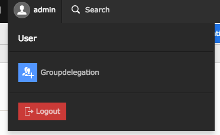
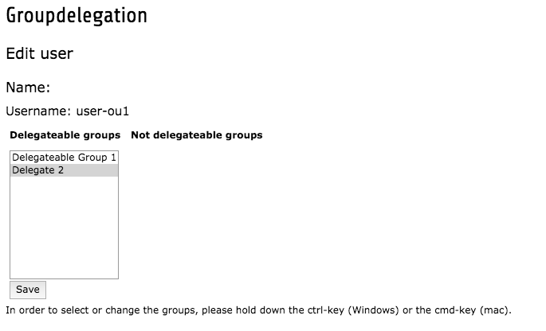
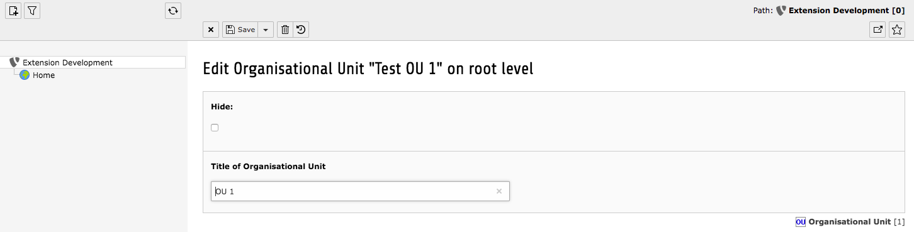
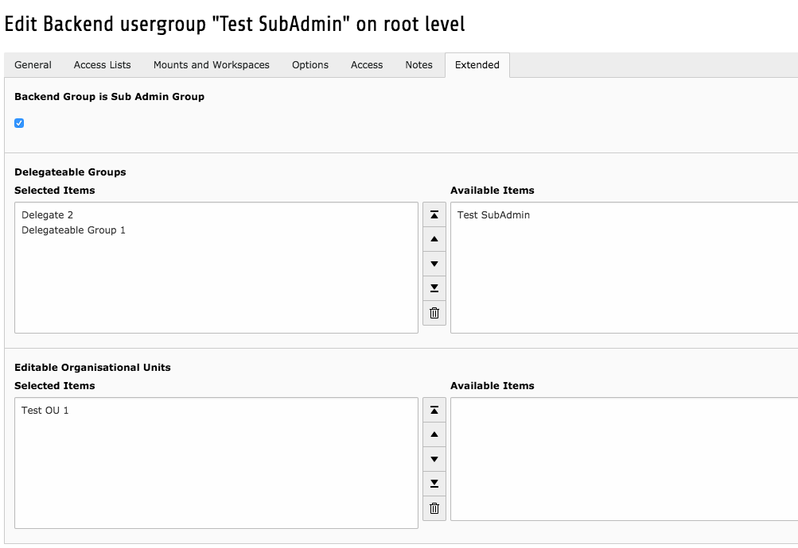

After initially creating this extension and later giving it over to in2code it is now back in the hands of Elementare Teilchen.
Thanks to in2code for the good collaboration in the last years.

> We are currently using this extension with TYPO3 v14. This should also work for v13.
Use version [v5.0.7](https://github.com/ElementareTeilchen/groupdelegation/releases/tag/v5.0.7) if you need it for v12.

# TYPO3 Extension groupdelegation

Allow editors with extended rights to set group rights for other editors.
This is highly recommended for installations with a lot of backend users like on universities.

## Introduction

The TYPO3 extension **goupdelegation** provides the possibility to allow certain be-users to delegate
certain be-groups to other be-users without having a TYPO3 admin account.
This can be done using organisation units or not.
That means e.g. you can determine that sub admin xx can only delegate groups to be-users of the organisation
unit marketing.

For a detailed manual have a look at the [Documentation](Documentation/) folder.

## Support
This TYPO3 Extension is free to use. We as TUM TYPO3 Team and elementare teilchen and our Developers highly appreciate your feedback and always try to improve our Extensions.

## Screens






## Installation

* Install this extension - e.g. via composer `composer require elementareteilchen/groupdelegation`
* Make your global configuration in the extension manager settings
* Configure the groups as you need (look at [Documentation](Documentation/) for details)
* Have fun!

## Development

We use [ddev for typo3 extensions](https://github.com/a-r-m-i-n/ddev-for-typo3-extensions)

Currently available in ddev is
- TYPO3 14.3 LTS

## Usage

### Requirements

The following software must be installed on the host machine:

- Docker
- Docker Compose
- DDEV

An internet connection is required during the initial setup to download images and Composer packages. After that, the environment can also be used offline in most cases.

### Start DDEV

With the `.ddev` directory in place, start the project with:

```bash
ddev start
```

This starts the containers, but it does not install any TYPO3 instance automatically.

### Install TYPO3 environments

The setup provides dedicated DDEV commands for provisioning separate TYPO3 instances:

```bash
ddev install-v14
```

To install all environments in one step, run:

```bash
ddev install-all
```

Each installation is created in its own directory inside the web container:

- `v14` for TYPO3 14.3

After the installation, the overview page is available at:

- https://groupdelegation.ddev.site/

The TYPO3 installations are available here:

-  https://v14.groupdelegation.ddev.site/typo3


### Credentials

All TYPO3 instances use the same backend and install tool credentials:

- Username: `admin`
- Password: `Password:joh316`

### TYPO3 CLI / typo3_console

You can run TYPO3 CLI commands directly inside each installation:

```bash
ddev exec v14/vendor/bin/typo3
```

TYPO3 14 also includes `helhum/typo3-console` as part of the installation.

### Remove the DDEV project

To delete the DDEV project and its containers, run:

```bash
ddev delete -Oy
```
